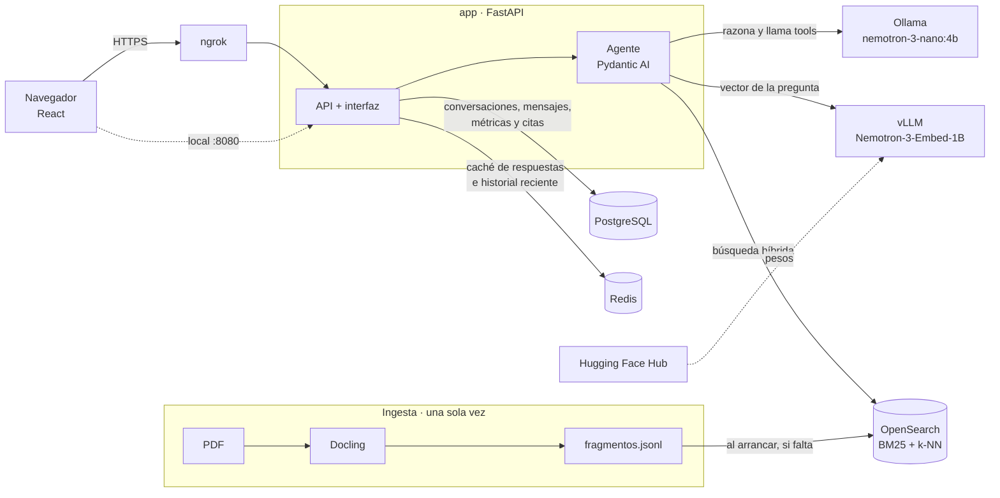
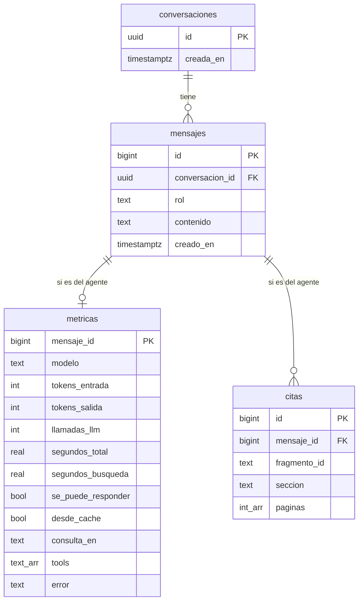

# Agente académico

Agente que responde preguntas sobre un artículo científico, con la sección y la página de donde sale
cada respuesta. Tiene un chat en React, un panel `/admin` con estadísticas, y todo el sistema
levanta con un solo `docker compose up`.

**Artículo:** Huang, Y. y Huang, J. X. (2026). *A Survey on Retrieval-Augmented Text Generation for
Large Language Models*. **ACM Computing Surveys** 58(12), artículo 300, pp. 1–38.
DOI [10.1145/3805774](https://doi.org/10.1145/3805774). Licencia
[CC BY 4.0](https://creativecommons.org/licenses/by/4.0/); el PDF se incluye en
`datos/huang2026-rag-survey.pdf` con esta atribución.

**Cuartil Q1:** según SCImago (SJR 2025), *ACM Computing Surveys* tiene SJR 5.985, es **Q1** y ocupa
el lugar 1 de 403 en *Computer Science (miscellaneous)*
([captura](docs/evidencia/sjr-acm-computing-surveys.png)). 2025 es el año más reciente publicado: el
SJR de 2026 sale a mediados de 2027.

**Integrantes:** _(completar)_

---

## Arquitectura



Recorrido de una pregunta:

1. El navegador manda la pregunta a `POST /api/chat`, junto con el id de la conversación.
2. La API trae los últimos 3 turnos, primero de Redis y, si no están, de PostgreSQL.
3. El agente de Pydantic AI llama la tool `buscar_en_articulo`. Le pasa la pregunta y su
   traducción al inglés; si la pregunta es de seguimiento («¿y cuál es su desventaja?»), la
   reescribe completa.
4. La tool vectoriza la pregunta con vLLM y hace una búsqueda híbrida en OpenSearch: BM25 sobre el
   inglés y vectores sobre la original. Devuelve los 5 mejores fragmentos y, si la pregunta nombra
   un estudio citado («REALM [48]»), su ficha de la bibliografía.
5. El LLM responde llamando la tool `responder`, con una salida tipada: texto, si el artículo lo
   cubre y qué fragmentos usó. Un validador revisa que haya buscado y que no cite fragmentos que
   la búsqueda no le dio.
6. La API convierte los fragmentos citados en sección y páginas, guarda todo en PostgreSQL y
   manda la respuesta por SSE. Mientras tanto, la interfaz muestra en vivo qué se está buscando.

### Rol de cada componente

| Componente | Rol |
|---|---|
| **Docling** 2.152 | Convierte el PDF conservando secciones, tablas, figuras con su pie y referencias (`ingesta/`) |
| **Hugging Face** | De ahí salen los modelos de embeddings y de Docling, y el tokenizador con que se parten los fragmentos |
| **vLLM** 0.25 | Sirve `nvidia/Nemotron-3-Embed-1B-BF16` (vectores de 2048) para indexar y para cada pregunta |
| **Ollama** 0.40 | Sirve el LLM `nemotron-3-nano:4b`, que razona, llama tools y redacta |
| **OpenSearch** 3.9 | Índice con k-NN (HNSW, Faiss, producto punto) y BM25 (analizador `english`) en los mismos documentos |
| **Pydantic AI** 2.75 | El agente: tools, salida tipada, validación con reintentos y memoria de la conversación |
| **PostgreSQL** 17 | Conversaciones, mensajes, métricas y citas (esquema normalizado) |
| **Redis** 7 | Caché de respuestas e historial reciente de cada conversación |
| **React** 19 + Vite | Chat y panel `/admin` |
| **Docker** | 8 servicios (uno solo descarga el LLM y termina) con healthchecks, volúmenes y variables en `.env` |
| **ngrok** | URL pública HTTPS para la demo |

---

## Instalación

Requisitos: Docker con soporte de GPU NVIDIA (en Windows, Docker Desktop con WSL2) y unos 40 GB
libres en disco para imágenes y modelos.

```bash
cp .env.example .env    # y llenar las claves (ver abajo)
docker compose up -d
```

La primera vez, Docker descarga las imágenes y los modelos: el LLM son 2.8 GB y los embeddings
2.3 GB. Después arma el índice a partir de `datos/procesado/fragmentos.jsonl`. Cuando `app` aparece
como `healthy` en `docker compose ps`, todo está listo.

| Variable de `.env` | Para qué |
|---|---|
| `POSTGRES_USER`, `POSTGRES_PASSWORD`, `POSTGRES_DB` | Credenciales de PostgreSQL |
| `ADMIN_TOKEN` | Token para entrar al panel `/admin` |
| `NGROK_AUTHTOKEN` | Token de la cuenta de ngrok ([dónde sacarlo](https://dashboard.ngrok.com/get-started/your-authtoken)) |
| `NGROK_URL` | Opcional: dominio fijo de la cuenta de ngrok (p. ej. `https://algo.ngrok-free.dev`); sin él, la URL cambia en cada arranque |

- **Chat:** http://127.0.0.1:8080
- **Panel:** http://127.0.0.1:8080/admin (pide el `ADMIN_TOKEN`)
- **URL pública:** la de `NGROK_URL`, o la que muestra el panel de ngrok en http://127.0.0.1:4040.
  Con la cuenta gratuita, ngrok muestra a cada visitante un aviso la primera vez; se pasa con
  **Visit Site**.

Todos los puertos escuchan solo en `127.0.0.1`. Desde fuera se entra únicamente por ngrok.

### Regenerar la ingesta (opcional)

Los fragmentos ya vienen en el repositorio. Para volver a generarlos desde el PDF (CPU, ~3 minutos,
Python 3.13 con [uv](https://docs.astral.sh/uv/)):

```bash
cd ingesta
uv sync
uv run python convertir.py      # PDF → articulo.json (Docling)
uv run python limpiar.py        # corrige títulos, palomitas, algoritmos y párrafos partidos
uv run python fragmentar.py     # → fragmentos.jsonl (268 fragmentos)
uv run python crear_indice.py --recrear && uv run python indexar.py
```

---

## Hardware y elección de modelos

| | |
|---|---|
| Equipo | ASUS ROG Zephyrus G14, Ryzen 9 270 (8 núcleos), 16 GB de RAM |
| GPU | NVIDIA RTX 5060 Laptop, **8 GB de VRAM** |
| Docker | Docker Desktop sobre WSL2, con tope de 8 GB de RAM |

Con 8 GB de VRAM, los dos modelos tienen que caber juntos en la GPU:

| Modelo | Servidor | VRAM medida | Por qué |
|---|---|---|---|
| `nemotron-3-nano:4b` (Q4_K_M) | Ollama | 3.0 GB | Hace tool calling, tiene contexto largo y cabe junto a los embeddings |
| `Nemotron-3-Embed-1B-BF16` | vLLM | 2.7 GB | Multilingüe: relaciona preguntas en español con el texto en inglés |
| **Total** | | **5.7 de 8.1 GB** | |

Los modelos más grandes sugeridos no caben: el `nemotron-3-nano:30b` pide 18–24 GB y
Qwen2.5-VL-7B en BF16 unos 16 GB. Docling corre en CPU para no competir por la VRAM.

Cada servidor tiene un rol claro:
- **vLLM** sirve los embeddings con el endpoint `/v2/embed`, que pone el prefijo correcto
  (`query:` o `passage:`) según el tipo de texto.
- **Ollama** sirve el LLM cuantizado en GGUF, con el modelo siempre cargado
  (`OLLAMA_KEEP_ALIVE=-1`) para evitar arranques en frío.

---

## Decisiones tomadas con datos

Cada decisión se tomó con un experimento chico y criterios fijados antes de medir. Los scripts
están en `experimentos/` y se pueden volver a correr.

### 1. Tablas con Docling (`experimentos/ingesta/probar_tablas.py`)

Prueba sobre la Tabla 3 (p. 23), de 57 × 13:

| Configuración | Estudios encontrados | Filas pegadas | Filas desalineadas |
|---|---|---|---|
| **TableFormer v1 ACCURATE con cell matching (elegida)** | **59** | 10 | **3** |
| v1 ACCURATE sin cell matching | 52 | 0 | 16 |
| TableFormer v2 | — (todo en una celda) | — | — |

En RAG, perder contenido es peor que tenerlo desordenado.

**Limitación:** la Tabla 3 conserva algunas filas pegadas. Por ejemplo, «REALM [48] kNN-LMs
[82]» queda en un solo renglón.

### 2. Fragmentos (`experimentos/ingesta/probar_fragmentos.py`)

- **512 tokens y tablas en Markdown.** Con Markdown, la Tabla 3 ocupa 8 fragmentos en lugar
  de 20, y cada uno repite el encabezado de columnas. Cinco fragmentos de 512 suman unos 2,500
  tokens, que caben en el contexto de 8,192 del LLM.
- **El chunking respeta la jerarquía.** Se usa el `HybridChunker` de Docling, y cada fragmento
  guarda su ruta de secciones («5 Post-Retrieval > 5.1 Re-Ranking») y sus páginas.
- **La limpieza previa** (`ingesta/limpiar.py`) corrige los problemas que dejó Docling:
  - asigna los niveles de los títulos;
  - recupera las subsecciones 2.1.x y 2.2.x;
  - quita títulos falsos;
  - convierte 265 palomitas ilegibles en ✓;
  - junta en un bloque cada uno de los 4 algoritmos;
  - une 11 párrafos partidos por tablas o por cambios de página.
- Resultado: **268 fragmentos**, 75 de contenido y 193 de bibliografía (una ficha por fragmento).

### 3. Analizador de BM25 (`experimentos/ingesta/probar_analizadores.py`)

| Analizador | Lugar 1 | MRR |
|---|---|---|
| `standard` | 9/15 | 0.702 |
| **`english` (elegido)** | **10/15** | **0.762** |

### 4. Búsqueda híbrida y evidencia de que mejora (`experimentos/ingesta/evaluar_busqueda.py`)

Son 25 preguntas (15 conceptuales y 10 de término exacto), y sus fragmentos correctos se fijaron a
mano **antes** de medir. Se evaluaron en tres condiciones: en inglés, en español, y en español con
la parte BM25 traducida al inglés (`es→en`, que es como trabaja el agente). Cada medición se repitió
5 veces.

| Método (condición `es→en`) | MRR | Recall@5 | Referencias en el top 5 |
|---|---|---|---|
| BM25 | 0.732 | 0.867 | 0.68 |
| Vector | 0.940 | 0.940 | 1.08 |
| Híbrida `min_max` 0.3/0.7 | 0.941 | 0.980 | 0.80 |
| **Híbrida `min_max` 0.3/0.7 sin referencias (elegida)** | **0.943** | **0.980** | **0** |
| Híbrida RRF 0.3/0.7 | 0.917 | 0.960 | 0.80 |

- **La búsqueda híbrida mejora la cobertura** (Recall@5 de 0.940 a 0.980) sin perder precisión en
  el primer lugar. La ganancia viene de preguntas con nombres propios, como RAPTOR o FILCO, que BM25
  encuentra aunque el vector los ubique más abajo.
- Con pesos iguales (0.5/0.5), la híbrida **empeora**: MRR 0.890 en inglés. BM25 sube fragmentos que
  el vector había dejado abajo con razón.
- **Traducir la parte BM25 es indispensable:** con la pregunta en español sin traducir, BM25 da MRR
  0.340.
- Las referencias se filtran porque ocupaban, en promedio, 1 de los 5 lugares que recibe el LLM.
  Las fichas se traen con una tool aparte, por su número de cita.
- Configuración final: **k = 5**. La curva de Recall@k se aplana desde k = 4.

### 5. Quién traduce la pregunta (`experimentos/agente/probar_traduccion.py`)

| Opción | MRR | Recall@5 | Costo |
|---|---|---|---|
| **A. El agente, al llamar la tool (elegida)** | **0.950** | 0.980 | ninguno extra |
| B. Una llamada aparte, solo para traducir | 0.943 | 0.980 | +0.3 s |

La opción A además reescribe las preguntas de seguimiento usando la conversación.

### 6. Cómo pedir la salida tipada (`experimentos/agente/probar_modos_salida.py`)

| Modo de Pydantic AI | Terminan | Buscaron antes de responder | Citas inventadas |
|---|---|---|---|
| `ToolOutput` con nombre de fábrica (`final_result`) | 3/6 | 6/6 | 1/3 |
| `NativeOutput` (JSON forzado) | 6/6 | **0/6** | 1/6 |
| `PromptedOutput` | 6/6 | **0/6** | 1/6 |
| **`ToolOutput` llamada `responder` + instrucción explícita (elegida)** | **6/6** | **6/6** | **0/6** |

Con JSON forzado desde la primera vuelta, el modelo nunca llega a llamar la búsqueda: responde de
memoria e inventa, por ejemplo «REALM es un sistema de gestión de identidad».

### 7. Otros hallazgos

- **Ollama crecía ~450 MB de RAM por pregunta.** `llama-server`, el motor de Ollama, guarda una
  caché de prompts en RAM con tope de 8 GB por defecto, y eso tumbaba a Docker a las ~10
  preguntas. Se limitó a 1 GB con `LLAMA_ARG_CACHE_RAM=1024`: ahora se estabiliza en 2.2 GB.
- **`thinking=False` de Pydantic AI no llega a Ollama** con este modelo. Se manda
  `reasoning_effort: "none"`, y la salida de una respuesta corta bajó de 61 a 3 tokens.
- **Una instrucción dinámica rompía el tool calling** (0 de 9 preguntas buscaban). El idioma de la
  respuesta se indica con una nota al final de la pregunta.

---

## Evaluación del agente (`evaluacion/`)

Son 25 preguntas:
- 15 conceptuales en español y 5 de término exacto en inglés, que el artículo sí responde;
- 5 que el artículo **no** responde.

Los resultados completos, pregunta por pregunta, están en
[`evaluacion/resultados_agente.json`](evaluacion/resultados_agente.json).

```bash
cd api && uv run python ../evaluacion/evaluar_agente.py
```

| Criterio | Resultado |
|---|---|
| Buscó en el artículo antes de responder | **25/25** |
| Respondió las que el artículo sí cubre | **20/20** |
| Citó al menos un fragmento correcto (fijado de antemano) | **20/20** |
| Respondió en el idioma de la pregunta | **25/25** |
| Se abstuvo en las que el artículo no cubre | **3/5** |
| LLM como juez: respuesta fiel a los fragmentos citados | 17/20 sí · 2 parcial · 1 no |
| LLM como juez: relevancia (1–5) | **4.9** |
| Tiempo promedio por pregunta | 6.2 s |

- En las 2 abstenciones fallidas, el agente sí dijo que el artículo no trata el tema («Los autores
  no expresan una opinión sobre las criptomonedas»), pero las marcó como respondibles.
- **El juez es el mismo LLM** de 4b, porque es el único que cabe en la GPU. Se le da la pregunta,
  la respuesta y el texto de los fragmentos citados.
- Con salida JSON forzada, el juez calificaba todo como «no» y 1. Por eso entrega su veredicto con
  una tool y razona antes de calificar.

---

## Persistencia y caché

Esquema de PostgreSQL ([`api/esquema.sql`](api/esquema.sql), con comentarios en cada tabla):



**Redis** tiene dos usos:
- **Caché de respuestas.** Solo para preguntas que abren una conversación: las de seguimiento
  dependen de lo anterior. La llave es la pregunta normalizada más el modelo, y dura 24 h.
  **Efecto medido:** 2 ms con la caché contra 7.4 s sin ella. El panel lo muestra en vivo.
- **Historial reciente** de cada conversación (los últimos 3 turnos), para no consultar PostgreSQL
  en cada pregunta.

---

## Panel `/admin`

Protegido con `Authorization: Bearer <ADMIN_TOKEN>`. Lee todo de PostgreSQL:
- preguntas y conversaciones;
- tokens de entrada y de salida, totales y por pregunta;
- tiempo promedio, separado en búsqueda y LLM;
- porcentaje de respuestas desde caché, con su latencia comparada;
- preguntas fuera del artículo y errores;
- una gráfica por día;
- la lista de preguntas y respuestas, con buscador, filtro de fechas y el detalle de cada una
  (modelo, llamadas al LLM, tools, consulta a BM25).

---

## Estructura del repositorio

```
api/            agente (Pydantic AI), búsqueda, API de FastAPI, esquema SQL, caché
web/            interfaz en React (chat y /admin)
ingesta/        PDF → fragmentos con Docling, creación del índice
evaluacion/     evaluación del agente (25 preguntas + LLM como juez) y sus resultados
experimentos/   experimentos que respaldan cada decisión (tablas, fragmentos, búsqueda, agente)
datos/          el artículo, los fragmentos y las traducciones de la evaluación
docs/evidencia/ captura del cuartil Q1
```

## Limitaciones

- La Tabla 3 conserva filas pegadas. Por eso «¿Qué es REALM?» mezcla REALM con kNN-LMs, aunque la
  ficha [48] sí llega al agente.
- El algoritmo 2 se leyó como tabla, y algunos de sus pasos quedan fuera de orden.
- La respuesta llega completa al final, porque el LLM responde con una llamada a tool. Lo que se
  transmite en vivo es el progreso: qué buscó y cuándo está redactando.
- El juez es el mismo modelo que responde. Un juez más grande sería más confiable, pero no cabe en
  esta GPU.
